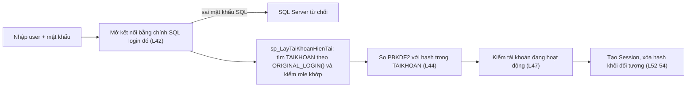

# TV5 — Sổ tay báo cáo & tra cứu mã nguồn

**Trần Đức Anh · MSSV 24110155 · Nhóm 06 · DBMS330284 · GVHD: TS. Phan Thị Thể**
Đối chiếu với source trên `main` ngày 22/10/2026. Mọi số dòng trong file này đã kiểm trực tiếp trên code.

> [!IMPORTANT]
> **Cách dùng:** Phần 1 là lời mở đầu 30 giây. Phần 2 là bảng tra cứu khi giảng viên hỏi "code ở đâu". Phần 3 đi qua từng chức năng theo cùng một khung: **Ở đâu → Mở trên giao diện → Nói gì → Bằng chứng → Giới hạn cần nói thật**. Phần 4 là kịch bản demo, Phần 5 là câu hỏi vấn đáp.

---

## 0. Những chỗ bản cũ ghi sai — KHÔNG được nói khi bảo vệ

Bản trước của file này có một số tên đối tượng và số liệu không khớp với code. Nếu nói theo bản cũ và giảng viên mở code ra, bạn sẽ bị bắt lỗi ngay.

| Bản cũ ghi | Thực tế trong code | Nguồn |
|---|---|---|
| `sp_MoLaiKyLuong` | **Không tồn tại.** Mở lại kỳ dùng `sp_HuyChotBangLuong` (do TV4 viết, TV5 cấp quyền) | [04_Module_TinhLuong_TV4.sql#L561](file:///c:/Users/DUCANHZZ/Downloads/HQTCSDL/PRJ/database/04_Module_TinhLuong_TV4.sql#L561) |
| Trigger `trg_ChamCong_ChanSuaKyDaChot`... | Tên đúng: `trg_ChamCong_KhongSuaKhiDaChotLuong`, `trg_PhuCap_...`, `trg_KhauTru_...`, cộng `trg_ChiTietLuong_KhongSuaKhiDaChot` → **4 trigger**, không phải 3 | [05#L164](file:///c:/Users/DUCANHZZ/Downloads/HQTCSDL/PRJ/database/05_Security_Payroll_TV5.sql#L164), [05#L432-L487](file:///c:/Users/DUCANHZZ/Downloads/HQTCSDL/PRJ/database/05_Security_Payroll_TV5.sql#L432-L487) |
| `sp_ChotBangLuong` có `@NguoiChot`, dùng `UPDLOCK, ROWLOCK`, `THROW` | Chỉ có `@MaBangLuong`; dùng **`UPDLOCK, HOLDLOCK`**; báo lỗi bằng **`RAISERROR`** | [05#L197-L262](file:///c:/Users/DUCANHZZ/Downloads/HQTCSDL/PRJ/database/05_Security_Payroll_TV5.sql#L197-L262) |
| `vw_PhieuLuongCaNhan` dùng `IS_MEMBER(...)`, Admin/Payroll "xem tất cả" qua view này | View chỉ lọc `tk.SqlLogin = ORIGINAL_LOGIN()` và chỉ **GRANT cho `role_Employee`**. HR/Payroll/Admin xem bảng tổng qua `vw_BangLuongChiTiet` | [05#L523-L532](file:///c:/Users/DUCANHZZ/Downloads/HQTCSDL/PRJ/database/05_Security_Payroll_TV5.sql#L523-L532) |
| HR bị `DENY` tính lương | HR chỉ bị **DENY tường minh `sp_ChotBangLuong`** và bảng `TAIKHOAN`. Tính lương thì HR **không được GRANT** (không có quyền), không phải DENY | [05#L332-L336](file:///c:/Users/DUCANHZZ/Downloads/HQTCSDL/PRJ/database/05_Security_Payroll_TV5.sql#L332-L336) |
| `PasswordUtil` dùng `char[]` + `Arrays.fill` | `Arrays.fill` nằm ở **`LoginFrame`**; `PasswordUtil` nhận `String` và xóa key spec bằng `spec.clearPassword()` | [LoginFrame.java#L286-L288](file:///c:/Users/DUCANHZZ/Downloads/HQTCSDL/PRJ/src/main/java/com/ui/auth/LoginFrame.java#L286-L288), [PasswordUtil.java#L36-L41](file:///c:/Users/DUCANHZZ/Downloads/HQTCSDL/PRJ/src/main/java/com/util/PasswordUtil.java#L36-L41) |
| Benchmark "142 → 15" là số duy nhất | Có **hai lượt đo thật**: 07/10 (actual plan) **142 → 15** và 13/10 (chạy lại) **126 → 13**. Cả hai đều giảm ≈ 89,5–89,7% | [README_EVIDENCE.md#L43-L48](file:///c:/Users/DUCANHZZ/Downloads/HQTCSDL/PRJ/Bo_nop_Nhom06/evidence/TV5/README_EVIDENCE.md#L43-L48), [summary.txt](file:///c:/Users/DUCANHZZ/Downloads/HQTCSDL/PRJ/Bo_nop_Nhom06/evidence/TV5/verification-20261013/summary.txt) |
| Concurrency chờ "1.10s, 1.04s..." là tính lương 2 phiên | Đó là **4 race chốt kỳ đối đầu sửa nguồn** (1101/1046/1042/1033 ms). Hai phiên **cùng tính lương** chờ **20631 ms** | [README_EVIDENCE.md#L30-L35](file:///c:/Users/DUCANHZZ/Downloads/HQTCSDL/PRJ/Bo_nop_Nhom06/evidence/TV5/README_EVIDENCE.md#L30-L35) |

> [!NOTE]
> Slide 17 hiện dùng số **142 → 15** (lượt 07/10). Số này đúng với actual plan, khớp ảnh Execution Plan bạn đang có. Khi nói, hãy ghi rõ "lượt đo ngày 07/10", và nếu được hỏi thì nhắc thêm lượt chạy lại ngày 13/10 ra 126 → 13.

---

## 1. Mở đầu 30 giây

> "Em là Trần Đức Anh, phụ trách **tích hợp kiến trúc, đăng nhập và phân quyền, chốt kỳ lương, kiểm soát đồng thời và tối ưu index** cho bảng nhân viên. Em sẽ trình bày bốn ý: **thứ nhất**, mỗi người dùng đăng nhập bằng SQL login riêng và quyền được SQL Server kiểm tra qua 4 database role. **Thứ hai**, nhân viên chỉ xem được phiếu lương của chính mình nhờ view lọc theo `ORIGINAL_LOGIN()`. **Thứ ba**, sau khi chốt kỳ, một procedure có khóa và 4 trigger đảm bảo số liệu không bị sửa, kể cả khi hai phiên chạy cùng lúc. **Thứ tư**, covering index giúp truy vấn lọc theo phòng ban và chức vụ giảm khoảng 90% số trang đọc."

**Ranh giới phần việc (nói đúng để không nhận công của bạn khác):**

| Của TV5 | Của thành viên khác, TV5 chỉ tích hợp hoặc cấp quyền |
|---|---|
| `sp_ChotBangLuong`, `fn_TinhThucNhan`, `vw_BangLuongChiTiet`, `vw_PhieuLuongCaNhan`, `trg_ChiTietLuong_KhongSuaKhiDaChot`, 3 trigger khóa nguồn, `IX_NHANVIEN_MaPB_MaCV`, 4 role và toàn bộ GRANT/DENY, các SP quản trị tài khoản | `sp_TinhBangLuongThang`, `sp_HuyChotBangLuong`, `sp_XoaBangLuongChuaChot` (TV4) · `sp_XoaKyLuongChuaChot` (TV3) · `sp_GhiNhanChamCong` (TV2) · `sp_ThemNhanVien` (TV1) |

---

## 2. Bảng tra cứu nhanh

Viết tắt: **05** = [`database/05_Security_Payroll_TV5.sql`](file:///c:/Users/DUCANHZZ/Downloads/HQTCSDL/PRJ/database/05_Security_Payroll_TV5.sql)

| # | Chức năng | File · dòng | Slide |
|:-:|---|---|:-:|
| 1 | Covering index thật trên `NHANVIEN` | [05#L92-L100](file:///c:/Users/DUCANHZZ/Downloads/HQTCSDL/PRJ/database/05_Security_Payroll_TV5.sql#L92-L100) | 17 |
| 2 | Function `fn_TinhThucNhan` | [05#L108-L119](file:///c:/Users/DUCANHZZ/Downloads/HQTCSDL/PRJ/database/05_Security_Payroll_TV5.sql#L108-L119) | 16 |
| 3 | View tổng `vw_BangLuongChiTiet` | [05#L129-L155](file:///c:/Users/DUCANHZZ/Downloads/HQTCSDL/PRJ/database/05_Security_Payroll_TV5.sql#L129-L155) | 16 |
| 4 | Trigger khóa chi tiết lương | [05#L164-L182](file:///c:/Users/DUCANHZZ/Downloads/HQTCSDL/PRJ/database/05_Security_Payroll_TV5.sql#L164-L182) | 16 |
| 5 | SP chốt lương `sp_ChotBangLuong` | [05#L197-L262](file:///c:/Users/DUCANHZZ/Downloads/HQTCSDL/PRJ/database/05_Security_Payroll_TV5.sql#L197-L262) | 16 |
| 6 | Tạo 4 role + DBAdmin vào `db_owner` | [05#L275-L299](file:///c:/Users/DUCANHZZ/Downloads/HQTCSDL/PRJ/database/05_Security_Payroll_TV5.sql#L275-L299) | 15 |
| 7 | Quyền `role_HRManager` | [05#L306-L336](file:///c:/Users/DUCANHZZ/Downloads/HQTCSDL/PRJ/database/05_Security_Payroll_TV5.sql#L306-L336), [L415-L419](file:///c:/Users/DUCANHZZ/Downloads/HQTCSDL/PRJ/database/05_Security_Payroll_TV5.sql#L415-L419) | 15 |
| 8 | Quyền `role_PayrollOfficer` | [05#L346-L376](file:///c:/Users/DUCANHZZ/Downloads/HQTCSDL/PRJ/database/05_Security_Payroll_TV5.sql#L346-L376), [L420-L428](file:///c:/Users/DUCANHZZ/Downloads/HQTCSDL/PRJ/database/05_Security_Payroll_TV5.sql#L420-L428) | 15 |
| 9 | Quyền `role_Employee` (REVOKE + DENY) | [05#L386-L400](file:///c:/Users/DUCANHZZ/Downloads/HQTCSDL/PRJ/database/05_Security_Payroll_TV5.sql#L386-L400) | 15 |
| 10 | 3 trigger khóa nguồn (phụ cấp, khấu trừ, chấm công) | [05#L432-L487](file:///c:/Users/DUCANHZZ/Downloads/HQTCSDL/PRJ/database/05_Security_Payroll_TV5.sql#L432-L487) | 16 |
| 11 | Đọc danh tính theo login `sp_LayTaiKhoanHienTai` | [05#L499-L511](file:///c:/Users/DUCANHZZ/Downloads/HQTCSDL/PRJ/database/05_Security_Payroll_TV5.sql#L499-L511) | 15 |
| 12 | View phiếu lương cá nhân (lọc theo dòng) | [05#L523-L532](file:///c:/Users/DUCANHZZ/Downloads/HQTCSDL/PRJ/database/05_Security_Payroll_TV5.sql#L523-L532) | 15 |
| 13 | SP quản trị: reset mật khẩu / đổi role / khóa | [05#L534-L622](file:///c:/Users/DUCANHZZ/Downloads/HQTCSDL/PRJ/database/05_Security_Payroll_TV5.sql#L534-L622) | 15 |
| 14 | DBA cấp login + user + role `sp_DBAProvisionIdentity` | [05#L626-L665](file:///c:/Users/DUCANHZZ/Downloads/HQTCSDL/PRJ/database/05_Security_Payroll_TV5.sql#L626-L665) | 15 |
| 15 | Mở lại kỳ `sp_HuyChotBangLuong` (TV4) | [04#L561](file:///c:/Users/DUCANHZZ/Downloads/HQTCSDL/PRJ/database/04_Module_TinhLuong_TV4.sql#L561) | 16 |
| 16 | Băm mật khẩu PBKDF2 | [PasswordUtil.java#L11-L41](file:///c:/Users/DUCANHZZ/Downloads/HQTCSDL/PRJ/src/main/java/com/util/PasswordUtil.java#L11-L41) | 15 |
| 17 | Luồng đăng nhập | [AuthService.java#L32-L60](file:///c:/Users/DUCANHZZ/Downloads/HQTCSDL/PRJ/src/main/java/com/service/AuthService.java#L32-L60) | 15 |
| 18 | Kết nối bằng login cá nhân, chặn URL chứa mật khẩu | [DatabaseConnection.java#L19-L58](file:///c:/Users/DUCANHZZ/Downloads/HQTCSDL/PRJ/src/main/java/com/config/DatabaseConnection.java#L19-L58) | 2 |
| 19 | Nút đăng nhập + SwingWorker + xóa `char[]` | [LoginFrame.java#L283-L307](file:///c:/Users/DUCANHZZ/Downloads/HQTCSDL/PRJ/src/main/java/com/ui/auth/LoginFrame.java#L283-L307) | 2 |
| 20 | Thanh đăng nhập nhanh (demo) | [LoginFrame.java#L150-L232](file:///c:/Users/DUCANHZZ/Downloads/HQTCSDL/PRJ/src/main/java/com/ui/auth/LoginFrame.java#L150-L232) | — |
| 21 | Chạy JDBC ngoài EDT (`DatabaseTask`) | [DatabaseTask.java#L18-L60](file:///c:/Users/DUCANHZZ/Downloads/HQTCSDL/PRJ/src/main/java/com/ui/theme/DatabaseTask.java#L18-L60) | 2 |
| 22 | Ẩn menu theo vai trò (lớp UI) | [MainFrame.java#L106-L128](file:///c:/Users/DUCANHZZ/Downloads/HQTCSDL/PRJ/src/main/java/com/ui/main/MainFrame.java#L106-L128) | 15 |
| 23 | Kiểm quyền ở Service (lớp giữa) | [PayrollService.java#L117-L204](file:///c:/Users/DUCANHZZ/Downloads/HQTCSDL/PRJ/src/main/java/com/service/PayrollService.java#L117-L204) | 15 |
| 24 | DAO gọi SP chốt / mở lại, đọc phiếu cá nhân | [BangLuongDAO.java#L140-L162](file:///c:/Users/DUCANHZZ/Downloads/HQTCSDL/PRJ/src/main/java/com/dao/BangLuongDAO.java#L140-L162), [L239-L241](file:///c:/Users/DUCANHZZ/Downloads/HQTCSDL/PRJ/src/main/java/com/dao/BangLuongDAO.java#L239-L241) | 16 |
| 25 | Nút Chốt / Mở lại / Xóa kỳ nháp | [BaoCaoPanel.java#L120-L133](file:///c:/Users/DUCANHZZ/Downloads/HQTCSDL/PRJ/src/main/java/com/ui/baocao/BaoCaoPanel.java#L120-L133), [L351-L454](file:///c:/Users/DUCANHZZ/Downloads/HQTCSDL/PRJ/src/main/java/com/ui/baocao/BaoCaoPanel.java#L351-L454) | 16 |
| 26 | Màn hình quản lý tài khoản | [TaiKhoanPanel.java](file:///c:/Users/DUCANHZZ/Downloads/HQTCSDL/PRJ/src/main/java/com/ui/admin/TaiKhoanPanel.java) | 15 |
| 27 | Script benchmark index | [test_benchmark_index_TV5.sql#L10-L72](file:///c:/Users/DUCANHZZ/Downloads/HQTCSDL/PRJ/database/test_benchmark_index_TV5.sql#L10-L72) | 17 |
| 28 | Script concurrency 2 phiên | [SessionA](file:///c:/Users/DUCANHZZ/Downloads/HQTCSDL/PRJ/database/tests/TV4_Payroll_Concurrency_SessionA.sql) · [SessionB](file:///c:/Users/DUCANHZZ/Downloads/HQTCSDL/PRJ/database/tests/TV4_Payroll_Concurrency_SessionB.sql) · [race nguồn](file:///c:/Users/DUCANHZZ/Downloads/HQTCSDL/PRJ/database/tests/Closed_Source_Concurrency.ps1) | 16–17 |
| 29 | Test phân quyền SQL (22 kiểm tra + 3 bị từ chối) | [test_security_roles_TV5.sql](file:///c:/Users/DUCANHZZ/Downloads/HQTCSDL/PRJ/database/test_security_roles_TV5.sql) | 17 |
| 30 | Bằng chứng tổng hợp TV5 | [README_EVIDENCE.md](file:///c:/Users/DUCANHZZ/Downloads/HQTCSDL/PRJ/Bo_nop_Nhom06/evidence/TV5/README_EVIDENCE.md) | 15–17 |

---

## 3. Chi tiết từng chức năng

### 3.1 Kiến trúc 3 tầng và tác vụ nền

**Ở đâu**
- Luồng: `LoginFrame` / các Panel → `AuthService`, `PayrollService` → `BangLuongDAO`, `TaiKhoanDAO` → SQL Server.
- Truy vấn chạy ngoài luồng giao diện: [DatabaseTask.java#L18-L60](file:///c:/Users/DUCANHZZ/Downloads/HQTCSDL/PRJ/src/main/java/com/ui/theme/DatabaseTask.java#L18-L60) (`run`, `runExclusive` bọc `SwingWorker`). Ví dụ sử dụng ở [BaoCaoPanel.java#L241](file:///c:/Users/DUCANHZZ/Downloads/HQTCSDL/PRJ/src/main/java/com/ui/baocao/BaoCaoPanel.java#L241).

**Nói gì**
> "Giao diện không gọi SQL trực tiếp. Mọi truy vấn đi qua Service rồi DAO. Truy vấn chạy trong `SwingWorker` qua lớp `DatabaseTask`, nên khi SQL chậm cửa sổ không bị treo. Kết quả được đưa lại luồng giao diện để cập nhật bảng. `runExclusive` chặn bấm lặp một nút ghi trong lúc thao tác cũ chưa xong."

**Giới hạn:** `SwingWorker` không tự hủy câu SQL đang chạy. Có kiểm timeout ở mức JDBC (`query-timeout-probe.log`, `SQLTimeoutException`), chưa kiểm hủy câu lệnh từ giao diện.

---

### 3.2 Đăng nhập: SQL login cá nhân + PBKDF2

**Ở đâu**
- Nút đăng nhập: [LoginFrame.java#L283-L307](file:///c:/Users/DUCANHZZ/Downloads/HQTCSDL/PRJ/src/main/java/com/ui/auth/LoginFrame.java#L283-L307). Lấy `char[]` rồi xóa bằng `Arrays.fill` ở L286–288; gọi `authService.login` trong `SwingWorker` ở L303–307.
- Xác thực: [AuthService.java#L32-L60](file:///c:/Users/DUCANHZZ/Downloads/HQTCSDL/PRJ/src/main/java/com/service/AuthService.java#L32-L60).
- Đọc hồ sơ theo login thật: [05#L499-L511](file:///c:/Users/DUCANHZZ/Downloads/HQTCSDL/PRJ/database/05_Security_Payroll_TV5.sql#L499-L511).
- Băm: [PasswordUtil.java#L11-L41](file:///c:/Users/DUCANHZZ/Downloads/HQTCSDL/PRJ/src/main/java/com/util/PasswordUtil.java#L11-L41).
- Chặn chuỗi kết nối chứa mật khẩu: [DatabaseConnection.java#L22](file:///c:/Users/DUCANHZZ/Downloads/HQTCSDL/PRJ/src/main/java/com/config/DatabaseConnection.java#L22).

**Luồng thật (AuthService L42–54)**



**Nói gì**
> "Đăng nhập có hai lớp. Lớp một: ứng dụng mở kết nối bằng chính SQL login của người dùng, nên sai mật khẩu thì SQL Server từ chối luôn. Lớp hai: procedure `sp_LayTaiKhoanHienTai` tìm hồ sơ theo `ORIGINAL_LOGIN()` và yêu cầu vai trò trong bảng `TAIKHOAN` phải khớp role SQL thật. Sau đó Java so mật khẩu với hash PBKDF2-HMAC-SHA256 600.000 vòng, salt 16 byte ngẫu nhiên, so sánh bằng `MessageDigest.isEqual` để tránh lộ thông tin qua thời gian so sánh. Tài khoản bị khóa thì không vào được. Hash cũ dạng SHA-256 tự được nâng cấp lên PBKDF2 ở lần đăng nhập đúng đầu tiên (L48–50)."

**Giới hạn cần nói thật:** `PasswordUtil` nhận mật khẩu dạng `String` (L14, L19), nên việc xóa `char[]` chỉ giảm thời gian mật khẩu nằm trong bộ nhớ, không loại bỏ hoàn toàn.

---

### 3.3 Bốn database role và GRANT / REVOKE / DENY

**Ở đâu:** [05#L275-L428](file:///c:/Users/DUCANHZZ/Downloads/HQTCSDL/PRJ/database/05_Security_Payroll_TV5.sql#L275-L428)

**Ma trận quyền đúng theo code**

| Đối tượng | `role_DBAdmin` | `role_HRManager` | `role_PayrollOfficer` | `role_Employee` |
|---|:-:|:-:|:-:|:-:|
| `PHONGBAN`, `CHUCVU`, `NHANVIEN` | db_owner | SELECT/INSERT/UPDATE/DELETE | SELECT · **DENY** ghi | **DENY** |
| `CHAMCONG`, `sp_GhiNhanChamCong` | db_owner | CRUD + EXECUTE | SELECT · **DENY** ghi và EXECUTE | **DENY** |
| `PHUCAPNHANVIEN`, `KHAUTRUNHANVIEN` | db_owner | CRUD | CRUD | **DENY** |
| `sp_TinhBangLuongThang` | db_owner | *không được cấp* | EXECUTE | *không được cấp* |
| `sp_ChotBangLuong` | db_owner | **DENY** | EXECUTE | *không được cấp* |
| `sp_HuyChotBangLuong`, xóa kỳ nháp | db_owner | *không được cấp* | EXECUTE | *không được cấp* |
| `BANGLUONG`, `CHITIETBANGLUONG` | db_owner | SELECT | SELECT, INSERT | **DENY** |
| `vw_BangLuongChiTiet` (bảng tổng) | db_owner | SELECT | SELECT | **REVOKE** |
| `vw_PhieuLuongCaNhan` (chỉ dòng của mình) | db_owner | — | — | SELECT |
| `TAIKHOAN` | db_owner | **DENY** | **DENY** | **DENY** |
| SP quản trị tài khoản | EXECUTE | — | — | — |

**Bảo vệ ba lớp, mỗi lớp có code riêng**

| Lớp | Ví dụ code | Vai trò |
|---|---|---|
| Giao diện | [MainFrame.java#L106-L128](file:///c:/Users/DUCANHZZ/Downloads/HQTCSDL/PRJ/src/main/java/com/ui/main/MainFrame.java#L106-L128) ẩn menu; [BaoCaoPanel.java#L454](file:///c:/Users/DUCANHZZ/Downloads/HQTCSDL/PRJ/src/main/java/com/ui/baocao/BaoCaoPanel.java#L454) tắt nút chốt | Cho người dùng thấy đúng chức năng của mình |
| Service | [PayrollService.java#L118](file:///c:/Users/DUCANHZZ/Downloads/HQTCSDL/PRJ/src/main/java/com/service/PayrollService.java#L118) `requireRoles("DB_Admin","Payroll_Officer")` | Chặn sớm, báo lỗi dễ hiểu |
| **SQL Server** | GRANT/DENY ở file 05 | **Lớp quyết định.** Dù client bị sửa, SQL vẫn từ chối |

**Nói gì**
> "Nhóm không dùng tài khoản `sa`. Mỗi người có SQL login riêng, được gán vào một trong 4 role. Ẩn menu chỉ là giao diện. Quyền thật nằm ở SQL Server: nếu ai đó sửa client để gọi thẳng `sp_ChotBangLuong` bằng tài khoản HR thì SQL Server vẫn báo *EXECUTE permission denied*."

**Bằng chứng:** [test_security_roles_TV5.log](file:///c:/Users/DUCANHZZ/Downloads/HQTCSDL/PRJ/Bo_nop_Nhom06/evidence/TV5/sql-verification/test_security_roles_TV5.log): **22 kiểm tra quyền, 3 thao tác bị từ chối, dọn dẹp PASS** (08/10, dùng `EXECUTE AS USER`).

**Giới hạn:** `role_DBAdmin` là thành viên `db_owner` của database, không phải quản trị server. Tạo SQL login mới cần `sysadmin` (`sp_DBAProvisionIdentity` L632).

---

### 3.4 Nhân viên chỉ xem phiếu lương của mình

**Ở đâu**
- View: [05#L523-L532](file:///c:/Users/DUCANHZZ/Downloads/HQTCSDL/PRJ/database/05_Security_Payroll_TV5.sql#L523-L532)
- DAO đọc view: [BangLuongDAO.java#L239-L241](file:///c:/Users/DUCANHZZ/Downloads/HQTCSDL/PRJ/src/main/java/com/dao/BangLuongDAO.java#L239-L241)
- Giao diện: menu **Báo cáo & Phiếu lương**, tiêu đề đổi thành **"Phiếu lương của tôi"** ([BaoCaoPanel.java#L167](file:///c:/Users/DUCANHZZ/Downloads/HQTCSDL/PRJ/src/main/java/com/ui/baocao/BaoCaoPanel.java#L167))

```sql
CREATE OR ALTER VIEW dbo.vw_PhieuLuongCaNhan AS
SELECT bl.* FROM dbo.vw_BangLuongChiTiet bl
JOIN dbo.TAIKHOAN tk ON tk.MaNV = bl.MaNV
WHERE tk.SqlLogin = ORIGINAL_LOGIN() AND tk.TrangThai = 'HOAT_DONG';
```

**Nói gì**
> "Employee bị DENY toàn bộ bảng gốc và bị REVOKE view tổng. Chỉ còn view cá nhân, lọc theo `ORIGINAL_LOGIN()` là login SQL Server đã xác thực. DAO có truyền `MaNV`, nhưng đó chỉ là lọc phụ. Nếu client giả mạo `MaNV` của người khác thì view vẫn trả **0 dòng**, vì điều kiện login nằm trong SQL."

**Bằng chứng:** [identity.log](file:///c:/Users/DUCANHZZ/Downloads/HQTCSDL/PRJ/Bo_nop_Nhom06/evidence/TV5/identity-agent/identity.log): **41 kiểm tra PASS**, gồm "Employee A đọc được dòng của mình, không đọc được B hoặc bảng tổng; giả Session không vượt quyền".

---

### 3.5 Chốt kỳ lương và mở lại

**Ở đâu**
- Procedure: [05#L197-L262](file:///c:/Users/DUCANHZZ/Downloads/HQTCSDL/PRJ/database/05_Security_Payroll_TV5.sql#L197-L262)
- Java: [BaoCaoPanel.java#L351](file:///c:/Users/DUCANHZZ/Downloads/HQTCSDL/PRJ/src/main/java/com/ui/baocao/BaoCaoPanel.java#L351) → [PayrollService.java#L117](file:///c:/Users/DUCANHZZ/Downloads/HQTCSDL/PRJ/src/main/java/com/service/PayrollService.java#L117) → [BangLuongDAO.java#L140-L141](file:///c:/Users/DUCANHZZ/Downloads/HQTCSDL/PRJ/src/main/java/com/dao/BangLuongDAO.java#L140-L141) `{CALL dbo.sp_ChotBangLuong(?)}`
- Mở lại: nút **Mở lại bảng lương** → `sp_HuyChotBangLuong` ([04#L561](file:///c:/Users/DUCANHZZ/Downloads/HQTCSDL/PRJ/database/04_Module_TinhLuong_TV4.sql#L561), TV4 viết)

**Các bước trong `sp_ChotBangLuong`**

| Bước | Dòng | Việc làm |
|:-:|:-:|---|
| 1 | L208 | `BEGIN TRANSACTION` trong `BEGIN TRY` |
| 2 | L213–215 | Đọc trạng thái kỳ với `WITH (UPDLOCK, HOLDLOCK)` → giữ khóa dòng đến khi commit |
| 3 | L218–227 | Không tồn tại → lỗi; đã `DA_CHOT` → lỗi "không thể chốt lại" |
| 4 | L230–237 | Kỳ chưa có chi tiết → không cho chốt bảng trống |
| 5 | L240–243 | `TrangThai = 'DA_CHOT'`, `NgayChot = GETDATE()` |
| 6 | L252–261 | `CATCH`: rollback nếu còn transaction, ném lại lỗi cho Java |

**Nói gì**
> "Chốt kỳ là một transaction. Procedure khóa dòng kỳ lương bằng `UPDLOCK, HOLDLOCK` ngay khi đọc trạng thái, nên hai người không thể cùng chốt. Nó kiểm tra kỳ có tồn tại, chưa chốt và đã có chi tiết lương, rồi mới ghi `DA_CHOT` và ngày chốt. Bất kỳ lỗi nào cũng rollback toàn bộ. Muốn sửa sau khi chốt thì Payroll hoặc Admin phải bấm **Mở lại bảng lương**, tính lại rồi chốt lại."

---

### 3.6 Bốn trigger khóa dữ liệu sau khi chốt

| Trigger | Bảng | Dòng | Cách xác định kỳ |
|---|---|:-:|---|
| `trg_ChiTietLuong_KhongSuaKhiDaChot` | `CHITIETBANGLUONG` | [L164](file:///c:/Users/DUCANHZZ/Downloads/HQTCSDL/PRJ/database/05_Security_Payroll_TV5.sql#L164) | `MaBangLuong` ở `inserted` ∪ `deleted` |
| `trg_PhuCap_KhongSuaKhiDaChotLuong` | `PHUCAPNHANVIEN` | [L432](file:///c:/Users/DUCANHZZ/Downloads/HQTCSDL/PRJ/database/05_Security_Payroll_TV5.sql#L432) | `Thang, Nam` |
| `trg_KhauTru_KhongSuaKhiDaChotLuong` | `KHAUTRUNHANVIEN` | [L451](file:///c:/Users/DUCANHZZ/Downloads/HQTCSDL/PRJ/database/05_Security_Payroll_TV5.sql#L451) | `Thang, Nam` |
| `trg_ChamCong_KhongSuaKhiDaChotLuong` | `CHAMCONG` | [L470](file:///c:/Users/DUCANHZZ/Downloads/HQTCSDL/PRJ/database/05_Security_Payroll_TV5.sql#L470) | `MONTH/YEAR(NgayChamCong)` |

**Ba điểm kỹ thuật nên nói**
1. Cả bốn đều `AFTER INSERT, UPDATE, DELETE` và gộp `inserted UNION deleted`. Cách này chặn cả trường hợp **chuyển** một dòng từ kỳ đã chốt sang kỳ khác (dòng cũ nằm ở `deleted`).
2. Đọc `BANGLUONG` với `UPDLOCK, HOLDLOCK`, nên trigger phối hợp khóa với `sp_ChotBangLuong` thay vì đọc trạng thái cũ.
3. Chặn ở tầng SQL nên áp dụng cho cả thao tác từ SSMS, không chỉ từ giao diện.

**Nói gì**
> "Sau khi chốt, bốn trigger khóa cả kết quả lẫn dữ liệu nguồn: chi tiết lương, chấm công, phụ cấp và khấu trừ của kỳ đó. Trigger xét cả `inserted` lẫn `deleted`, nên chặn được thêm, sửa, xóa và cả việc chuyển dòng sang kỳ khác."

---

### 3.7 Kiểm soát đồng thời

**Ở đâu:** khóa trong [05#L213-L215](file:///c:/Users/DUCANHZZ/Downloads/HQTCSDL/PRJ/database/05_Security_Payroll_TV5.sql#L213-L215) và trong các trigger; script [SessionA](file:///c:/Users/DUCANHZZ/Downloads/HQTCSDL/PRJ/database/tests/TV4_Payroll_Concurrency_SessionA.sql) / [SessionB](file:///c:/Users/DUCANHZZ/Downloads/HQTCSDL/PRJ/database/tests/TV4_Payroll_Concurrency_SessionB.sql) / [Closed_Source_Concurrency.ps1](file:///c:/Users/DUCANHZZ/Downloads/HQTCSDL/PRJ/database/tests/Closed_Source_Concurrency.ps1). File [test_concurrency_demo_TV5.sql](file:///c:/Users/DUCANHZZ/Downloads/HQTCSDL/PRJ/database/test_concurrency_demo_TV5.sql) chỉ là file chỉ đường tới các script này.

| Kịch bản | Kết quả đo thật | Log |
|---|---|---|
| **Hai phiên cùng tính lương một kỳ** (07/10, kỳ 01/2020) | Phiên A (SPID 77) giữ khóa; phiên B (SPID 83) chờ **20.631 ms** rồi hoàn tất. **1 header, 1 chi tiết, 0 nhóm trùng**, cleanup PASS | [Concurrency_A.log](file:///c:/Users/DUCANHZZ/Downloads/HQTCSDL/PRJ/Bo_nop_Nhom06/evidence/TV5/fix-verification/Concurrency_A.log), [Concurrency_B.log](file:///c:/Users/DUCANHZZ/Downloads/HQTCSDL/PRJ/Bo_nop_Nhom06/evidence/TV5/fix-verification/Concurrency_B.log) |
| **Chốt kỳ đối đầu sửa nguồn** (08/10, 4 race: chấm công / phụ cấp / khấu trừ / chi tiết) | Chờ **1101 / 1046 / 1042 / 1033 ms**, cả 4 đều **bị từ chối**, dữ liệu nguồn không đổi | [Closed_Source_Concurrency.log](file:///c:/Users/DUCANHZZ/Downloads/HQTCSDL/PRJ/Bo_nop_Nhom06/evidence/TV5/sql-verification/Closed_Source_Concurrency.log) |

**Nói gì**
> "Có hai kịch bản tranh chấp đã chạy thật bằng hai kết nối. Một: hai phiên cùng tính lương một kỳ. Phiên sau phải chờ khoảng 20,6 giây đến khi phiên trước commit, và chỉ có đúng 1 bảng lương, không có dòng trùng. Hai: một phiên đang chốt kỳ, phiên kia cố sửa chấm công, phụ cấp, khấu trừ hoặc chi tiết. Cả bốn thao tác sửa đều phải chờ khoảng 1 giây rồi bị trigger từ chối, dữ liệu nguồn không đổi."

**Giới hạn:** Đây là kịch bản cố định trong script, chưa phải kiểm tải nhiều người dùng; chưa thử phục hồi deadlock hay backup/restore.

---

### 3.8 Tối ưu index và kế hoạch thực thi

**Ở đâu**
- Index thật trên bảng `NHANVIEN`: [05#L92-L100](file:///c:/Users/DUCANHZZ/Downloads/HQTCSDL/PRJ/database/05_Security_Payroll_TV5.sql#L92-L100) — `IX_NHANVIEN_MaPB_MaCV (MaPB, MaCV) INCLUDE (MaNV, HoTen, LuongCoBan, TrangThai)`
- Benchmark trên bảng tạm 10.000 dòng: [test_benchmark_index_TV5.sql](file:///c:/Users/DUCANHZZ/Downloads/HQTCSDL/PRJ/database/test_benchmark_index_TV5.sql)
  - Sinh dữ liệu L10–18: `MaPB = n % 4 + 1`, `MaCV = n % 3 + 1` → điều kiện `MaPB = 2 AND MaCV = 1` ứng với `n % 12 = 9` → đúng **833 dòng**
  - Tạo index L19–22, đo "trước" L36–38 (ép `INDEX(PK_Bench_MaNV)`), đo "sau" L50–52 (ép `INDEX(IX_Bench_MaPB_MaCV)`)
  - L57–61: đối chiếu hai chiều bằng `EXCEPT` để chứng minh kết quả trước và sau giống hệt nhau

**Số liệu**

| Chỉ số | Clustered Index Scan | Index Seek (covering) | Thay đổi |
|---|:-:|:-:|:-:|
| Dòng phải đọc (`Actual Rows Read`) | 10.000 | 833 | −91,7% |
| Logical reads — lượt 07/10, actual plan | **142** | **15** | −89,4% |
| Logical reads — lượt 13/10, chạy lại | **126** | **13** | −89,7% |
| Estimated I/O cost | 0,106829 | 0,0109645 | −89,7% |
| Estimated subtree cost | 0,117986 | 0,0120382 | ≈ 9,8 lần |
| Có Key Lookup không | — | **Không** | covering index |

Nguồn: [README_EVIDENCE.md#L43-L48](file:///c:/Users/DUCANHZZ/Downloads/HQTCSDL/PRJ/Bo_nop_Nhom06/evidence/TV5/README_EVIDENCE.md#L43-L48), plan [TV5_ActualPlan_4.sqlplan](file:///c:/Users/DUCANHZZ/Downloads/HQTCSDL/PRJ/Bo_nop_Nhom06/evidence/TV5/fix-verification/TV5_ActualPlan_4.sqlplan) / [TV5_ActualPlan_5.sqlplan](file:///c:/Users/DUCANHZZ/Downloads/HQTCSDL/PRJ/Bo_nop_Nhom06/evidence/TV5/fix-verification/TV5_ActualPlan_5.sqlplan), log [TV5_Benchmark.messages.log](file:///c:/Users/DUCANHZZ/Downloads/HQTCSDL/PRJ/Bo_nop_Nhom06/evidence/TV5/verification-20261013/TV5_Benchmark.messages.log).

**Nói gì (theo đúng 2 ảnh Execution Plan trên slide 17)**
> "Trước khi tối ưu, SQL Server dùng **Clustered Index Scan**: đọc hết 10.000 dòng rồi mới lọc bằng `Predicate`, để lấy 833 dòng. Sau khi có index `(MaPB, MaCV)`, SQL Server dùng **Index Seek** với `Seek Predicates`: đi theo cây B-Tree đến đúng vùng `MaPB=2, MaCV=1`, chỉ đọc 833 dòng. Vì các cột cần hiển thị đã nằm trong `INCLUDE`, nên plan **không có Key Lookup** quay về bảng chính. Logical reads giảm từ 142 xuống 15, khoảng 89%. Lượt chạy lại ngày 13/10 cho kết quả tương tự là 126 xuống 13."

**Giới hạn cần nói thật (chủ động nói sẽ được đánh giá cao)**
- Benchmark **ép đường truy cập bằng hint** để so sánh công bằng hai phương án; không khẳng định optimizer luôn tự chọn như vậy trên dữ liệu thật.
- Thời gian chạy chỉ 0–3 ms, quá nhỏ để kết luận về tốc độ. Kết luận dựa trên **số trang đọc**, không dựa trên mili giây.
- `MaNV` trong `INCLUDE` của index thật là thừa, vì khóa clustered đã có sẵn ở mọi nonclustered index. Nếu bị hỏi, thừa nhận là có thể bỏ.

---

### 3.9 Kiểm thử tự động

| Bộ kiểm thử | Số assertion | Log |
|---|:-:|---|
| `SecurityRegressionTest` | 104 | [Java_Security.log](file:///c:/Users/DUCANHZZ/Downloads/HQTCSDL/PRJ/Bo_nop_Nhom06/evidence/TV5/package-integration-20261015/Java_Security.log) |
| `GuiQaRegressionTest` | 88 | [Java_GuiQa.log](file:///c:/Users/DUCANHZZ/Downloads/HQTCSDL/PRJ/Bo_nop_Nhom06/evidence/TV5/package-integration-20261015/Java_GuiQa.log) |
| `LightThemeRegressionTest` | 45 | [Java_LightTheme.log](file:///c:/Users/DUCANHZZ/Downloads/HQTCSDL/PRJ/Bo_nop_Nhom06/evidence/TV5/package-integration-20261015/Java_LightTheme.log) |
| `LoginChipRegressionTest` | 20 | [Java_LoginChip.log](file:///c:/Users/DUCANHZZ/Downloads/HQTCSDL/PRJ/Bo_nop_Nhom06/evidence/TV5/package-integration-20261015/Java_LoginChip.log) |
| **Tổng Java offline** | **257** | [README](file:///c:/Users/DUCANHZZ/Downloads/HQTCSDL/PRJ/Bo_nop_Nhom06/evidence/TV5/package-integration-20261015/README.md) |
| SQL phân quyền (`EXECUTE AS USER`) | 22 kiểm tra + 3 bị từ chối | [test_security_roles_TV5.log](file:///c:/Users/DUCANHZZ/Downloads/HQTCSDL/PRJ/Bo_nop_Nhom06/evidence/TV5/sql-verification/test_security_roles_TV5.log) |
| Danh tính thật (login A/B) | 41 + 9 = 50 | [identity.log](file:///c:/Users/DUCANHZZ/Downloads/HQTCSDL/PRJ/Bo_nop_Nhom06/evidence/TV5/identity-agent/identity.log) |
| GUI chạy thật với SQL | 87 | [gui-followup README](file:///c:/Users/DUCANHZZ/Downloads/HQTCSDL/PRJ/Bo_nop_Nhom06/evidence/TV5/gui-followup-20261013/README.md) |

> [!WARNING]
> **257 là test Java không kết nối SQL.** Đừng nói "257 test kiểm tra toàn bộ hệ thống". Hãy nói: "257 assertion Java offline, cộng với các bộ kiểm tra SQL và danh tính chạy riêng". Các con số không được cộng dồn với nhau.

---

### 3.10 Thanh đăng nhập nhanh (chỉ dùng cho demo)

**Ở đâu:** [LoginFrame.java#L150-L232](file:///c:/Users/DUCANHZZ/Downloads/HQTCSDL/PRJ/src/main/java/com/ui/auth/LoginFrame.java#L150-L232). Bấm 1 lần để điền thông tin; nhấp đúp để đăng nhập luôn. Ẩn bằng `-Dapp.hideDemo=true`.

> [!CAUTION]
> Mật khẩu 5 tài khoản demo đang **nằm trực tiếp trong source** (L170–177). Giảng viên hỏi về bảo mật thì **chủ động nhận**: "Đây là tiện ích chỉ cho buổi demo trên database QA. Bản triển khai thật phải chạy với `-Dapp.hideDemo=true` và xóa các dòng này. Các tài khoản demo vẫn phải qua đủ hai lớp xác thực SQL + PBKDF2, không có đường tắt bỏ qua xác thực."

---

## 4. Kịch bản demo 120 giây

**Chuẩn bị trước giờ bảo vệ**
- Chạy ứng dụng: `powershell -NoProfile -ExecutionPolicy Bypass -File .\start_app.ps1`
- Kỳ **10/2026** đã được tính, đang ở trạng thái **Bản nháp** (`CHUA_CHOT`). Kiểm tra A = **730.000đ**, B = **0đ**.
- Không tạo thêm nhân viên hay chấm công để "ép" số liệu.

| Thời gian | Tài khoản | Thao tác | Kết quả cần chỉ cho giảng viên |
|:-:|---|---|---|
| 0–25s | **Kế toán** (nhấp đúp) | **Báo cáo & Phiếu lương** → chọn 10/2026 → **Chốt bảng lương** → Xác nhận | Trạng thái chuyển **Đã chốt**, có ngày chốt, số tiền không đổi |
| 25–60s | **HR Manager** | **Nhật ký chấm công** → thêm công cho A ngày **2026-10-10**, 08:00–17:00, *Có mặt* | Báo lỗi *"Kỳ lương đã chốt: không được thay đổi chấm công."*. Dùng ngày chưa có công để không bị lỗi trùng ngày che mất |
| 60–85s | **Nhân viên A** | **Báo cáo & Phiếu lương** (tiêu đề **Phiếu lương của tôi**) | Chỉ có dòng của A (730.000đ), không có B hay bảng tổng |
| 85–100s | **Nhân viên B** | Mở cùng màn hình | Chỉ thấy phiếu 0đ của B |
| 100–120s | **Kế toán** | **Mở lại bảng lương** → **Làm mới** | Kỳ về **Bản nháp**, sẵn sàng cho lượt demo sau |

> [!TIP]
> Bước cuối **không được bỏ**. Nếu quên mở lại kỳ, lượt demo sau (hoặc phần của TV4) sẽ bị trigger chặn. Nếu thiếu thời gian, bỏ bước B, giữ bước mở lại.

**Phương án dự phòng trong SSMS** (kết nối bằng chính login `gui_a`, không dùng tài khoản DBA):

```sql
SELECT ORIGINAL_LOGIN() AS LoginDangKetNoi, IS_ROLEMEMBER('role_Employee') AS LaEmployee;
SELECT MaNV, HoTen, Thang, Nam, ThucNhan FROM dbo.vw_PhieuLuongCaNhan;   -- chỉ 1 dòng
SELECT * FROM dbo.vw_BangLuongChiTiet;                                    -- phải báo permission denied
```

---

## 5. Câu hỏi vấn đáp

**Câu 1. Tại sao dùng PBKDF2 mà không dùng MD5 hay SHA-256?**
> "MD5 và SHA-256 là hàm băm nhanh, GPU thử được hàng tỷ mật khẩu mỗi giây. PBKDF2 lặp 600.000 vòng HMAC-SHA256 nên mỗi lần thử chậm hơn hàng trăm nghìn lần; salt 16 byte ngẫu nhiên khiến hai người cùng mật khẩu vẫn có hash khác nhau, vô hiệu hóa bảng tra sẵn."
→ [PasswordUtil.java#L11-L17](file:///c:/Users/DUCANHZZ/Downloads/HQTCSDL/PRJ/src/main/java/com/util/PasswordUtil.java#L11-L17)

**Câu 2. Đã có SQL login rồi, sao còn cần hash trong bảng `TAIKHOAN`?**
> "SQL login xác thực với SQL Server. Bảng `TAIKHOAN` giữ trạng thái khóa/mở, vai trò ứng dụng và liên kết `MaNV`. Ứng dụng yêu cầu cả hai khớp nhau: login đúng, hồ sơ đang hoạt động, vai trò trong bảng trùng role SQL thật. Admin khóa tài khoản thì `sp_AdminSetStatus` vừa `DISABLE` login SQL vừa đổi trạng thái trong bảng, trong cùng một transaction."
→ [AuthService.java#L42-L47](file:///c:/Users/DUCANHZZ/Downloads/HQTCSDL/PRJ/src/main/java/com/service/AuthService.java#L42-L47), [05#L598-L620](file:///c:/Users/DUCANHZZ/Downloads/HQTCSDL/PRJ/database/05_Security_Payroll_TV5.sql#L598-L620)

**Câu 3. `REVOKE` khác `DENY` thế nào? Em dùng ở đâu?**
> "`REVOKE` gỡ một quyền đã cấp, người dùng vẫn có thể nhận lại quyền đó qua role khác. `DENY` là cấm tường minh và **luôn thắng GRANT**. Em dùng `REVOKE SELECT` view tổng khỏi Employee (L387) và `DENY` các bảng gốc (L390–400), `DENY EXECUTE sp_ChotBangLuong` cho HR (L333)."
→ [05#L333](file:///c:/Users/DUCANHZZ/Downloads/HQTCSDL/PRJ/database/05_Security_Payroll_TV5.sql#L333), [05#L387-L400](file:///c:/Users/DUCANHZZ/Downloads/HQTCSDL/PRJ/database/05_Security_Payroll_TV5.sql#L387-L400)

**Câu 4. Employee bị DENY bảng gốc, sao vẫn đọc được qua view?**
> "Nhờ **ownership chaining**: view và bảng cùng chủ sở hữu `dbo`, nên SQL Server chỉ kiểm quyền trên view, không kiểm lại trên bảng bên dưới. Employee được SELECT view cá nhân nhưng vẫn không thể SELECT trực tiếp bảng."

**Câu 5. Tại sao dùng `ORIGINAL_LOGIN()` mà không dùng `SUSER_SNAME()`?**
> "`SUSER_SNAME()` thay đổi theo ngữ cảnh khi có `EXECUTE AS`. `ORIGINAL_LOGIN()` luôn trả về login đã kết nối ban đầu, nên không thể dùng chuyển ngữ cảnh để đọc phiếu lương người khác."

**Câu 6. Client sửa `MaNV` để xem lương người khác được không?**
> "Không. DAO có truyền `MaNV`, nhưng view đã lọc theo login thật ở SQL. Truyền `MaNV` của B khi đang đăng nhập A thì view trả 0 dòng. Log danh tính 07/10 đã kiểm trường hợp giả Session."
→ [BangLuongDAO.java#L241](file:///c:/Users/DUCANHZZ/Downloads/HQTCSDL/PRJ/src/main/java/com/dao/BangLuongDAO.java#L241), [05#L528](file:///c:/Users/DUCANHZZ/Downloads/HQTCSDL/PRJ/database/05_Security_Payroll_TV5.sql#L528)

**Câu 7. Tại sao HR không được chốt lương? Có phải HR ít quyền hơn Payroll?**
> "Không ít hơn, mà là **tách trách nhiệm**. HR độc quyền ghi hồ sơ, phòng ban, chức vụ, chấm công; Payroll bị DENY các thao tác đó. Ngược lại, Payroll tính và chốt lương, còn HR bị DENY chốt. Nếu một người vừa tạo được nhân viên và công, vừa chốt được tiền, người đó có thể tạo 'nhân viên ma' rồi tự duyệt chi. Tách hai vai trò buộc dữ liệu phải qua kiểm soát chéo."

**Câu 8. `UPDLOCK, HOLDLOCK` để làm gì? Sao không chỉ `UPDLOCK`?**
> "`UPDLOCK` cho phép phiên khác đọc nhưng không cho hai phiên cùng giữ quyền chuẩn bị cập nhật một dòng, tránh deadlock kiểu 'cùng đọc rồi cùng ghi'. `HOLDLOCK` giữ khóa đến cuối transaction như mức `SERIALIZABLE`, nên giữa lúc kiểm trạng thái và lúc `UPDATE` không ai chen vào đổi trạng thái được."
→ [05#L213-L215](file:///c:/Users/DUCANHZZ/Downloads/HQTCSDL/PRJ/database/05_Security_Payroll_TV5.sql#L213-L215)

**Câu 9. Sao plan sau tối ưu không có Key Lookup?**
> "Vì là covering index. Cột lọc `MaPB, MaCV` nằm ở khóa; cột cần hiển thị `HoTen, LuongCoBan, TrangThai` nằm ở `INCLUDE`, còn `MaNV` là khóa clustered nên có sẵn ở tầng lá. Tất cả cột của câu `SELECT` đều có trong index, không phải quay về bảng chính."
→ [test_benchmark_index_TV5.sql#L20-L21](file:///c:/Users/DUCANHZZ/Downloads/HQTCSDL/PRJ/database/test_benchmark_index_TV5.sql#L20-L21)

**Câu 10. Em ép hint trong benchmark, vậy có công bằng không?**
> "Mục đích là so sánh hai đường truy cập trên cùng dữ liệu, cùng điều kiện, nên em ép hint, `MAXDOP 1` và chạy với cache đã nóng. Script còn dùng `EXCEPT` hai chiều để chứng minh kết quả trước và sau giống hệt nhau. Đây là phép so sánh đường truy cập, không phải tuyên bố về tải thực tế."
→ [test_benchmark_index_TV5.sql#L36-L61](file:///c:/Users/DUCANHZZ/Downloads/HQTCSDL/PRJ/database/test_benchmark_index_TV5.sql#L36-L61)

**Câu 11. Sao có hai bộ số 142→15 và 126→13?**
> "Hai lượt đo khác ngày trên cùng script. Lượt 07/10 lấy từ actual plan XML, lượt 13/10 chạy lại khi đóng gói. Số trang lệch do phân bố trang của bảng tạm mỗi lần tạo, nhưng tỷ lệ giảm đều khoảng 89–90%. Nhóm giữ nguyên cả hai, không sửa số."

**Câu 12. Hai người cùng bấm Tính lương thì sao?**
> "Procedure tính lương khóa header kỳ bằng `UPDLOCK, HOLDLOCK`. Phiên thứ hai phải chờ. Log thật: phiên B chờ 20.631 ms, kết quả chỉ 1 header, không có dòng trùng."
→ [04#L274](file:///c:/Users/DUCANHZZ/Downloads/HQTCSDL/PRJ/database/04_Module_TinhLuong_TV4.sql#L274), [Concurrency_B.log](file:///c:/Users/DUCANHZZ/Downloads/HQTCSDL/PRJ/Bo_nop_Nhom06/evidence/TV5/fix-verification/Concurrency_B.log)

---

## 6. Checklist trước giờ bảo vệ

- [ ] SQL Server đang chạy, `start_app.ps1` mở được màn hình đăng nhập
- [ ] Nhấp đúp được cả 5 chip; HR không thấy menu **Bảng lương**, Employee không thấy menu **Hồ sơ nhân viên**
- [ ] Kỳ 10/2026 đang là **Bản nháp**; A = 730.000đ, B = 0đ
- [ ] Mở sẵn trong VS Code: file 05 (L197, L333, L470, L523), `PasswordUtil.java`, `test_benchmark_index_TV5.sql`
- [ ] Mở sẵn trong SSMS: 2 ảnh Execution Plan, hoặc file `.sqlplan` 4 và 5
- [ ] Học thuộc 4 con số: **833 / 10.000 dòng**, **142 → 15 reads**, **20.631 ms**, **257 assertion Java**
- [ ] Đọc lại Phần 0 để không nói nhầm tên `sp_MoLaiKyLuong` hay tên trigger cũ
